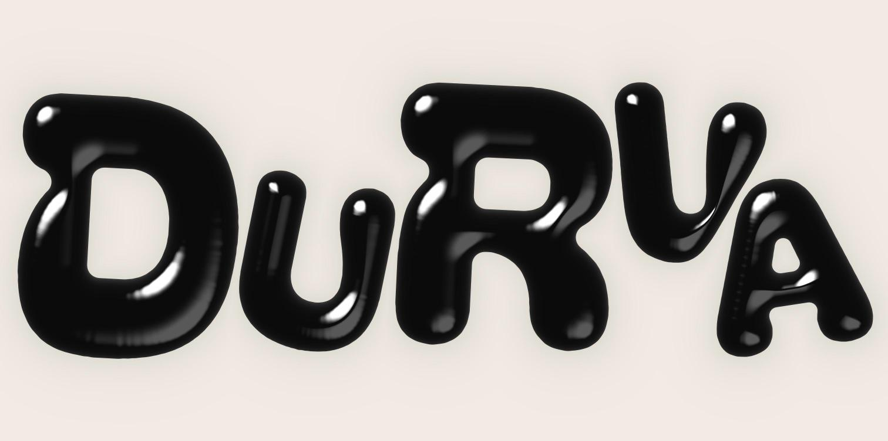
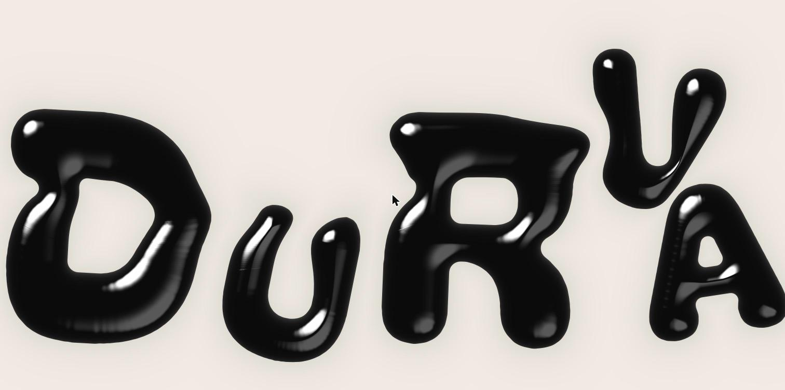

# balloon-type

Glossy, inflated balloon letters for React. Type any word. Push the letters around with your cursor or finger, and they melt and smear like warm wax.

**[Live demo →](https://durvagaikwad.github.io/balloon-type/)**

| At rest | Melting |
| --- | --- |
|  |  |

- **Any word, packed tight.** Letters are scattered with random sizes and tilts, then grown until they pack together with no gaps. They fill 90% of the view, leaving room all around (`scale: 1` goes edge to edge). The text still reads left to right, top to bottom.
- **Real gloss.** Each glyph becomes a signed distance field, inflated into a dome and lit with sharp highlights.
- **Melt + physics.** A cursor flowmap bends the surface. Letters are free bodies that collide by their actual shapes, so they never overlap.
- **Respectful.** Static under `prefers-reduced-motion`, pauses offscreen, and is labelled for screen readers.

## Install

```bash
npm install balloon-type three @react-three/fiber
```

Requires React 18 or 19. Use `@react-three/fiber` v8 with React 18, or v9 with React 19.

## Usage

```tsx
import { BalloonType } from "balloon-type";

export default function Hero() {
  return (
    <div style={{ height: "100vh" }}>
      <BalloonType text="HELLO" />
    </div>
  );
}
```

The component fills its parent, so **give the parent a height**.

### Fonts

The default font is [Bagel Fat One](https://fonts.google.com/specimen/Bagel+Fat+One). Load it yourself, since the package doesn't bundle any fonts. Chunky, rounded display fonts look best.

**Google Fonts:**

```html
<link href="https://fonts.googleapis.com/css2?family=Bagel+Fat+One&display=swap" rel="stylesheet" />
```

**Next.js (`next/font`):**

```tsx
import { Bagel_Fat_One } from "next/font/google";
const bagel = Bagel_Fat_One({ subsets: ["latin"], weight: "400" });

<BalloonType text="HELLO" fontFamily={bagel.style.fontFamily} />;
```

The component is client-only (it ships with `"use client"`), so it works in the App Router as-is.

## Props

| Prop | Type | Default | |
| --- | --- | --- | --- |
| `text` | `string` | (required) | Spaces separate words. `"\n"` starts a new line. Up to 48 letters. |
| `fontFamily` | `string` | Bagel Fat One | Any loaded CSS font family. |
| `fontWeight` | `number \| string` | `400` | |
| `background` | `string` | `#F1ECE3` | |
| `ink` | `string` | `#0b0b0c` | Letter colour. |
| `seed` | `number` | `1` | Change it for a different auto layout. |
| `arrangement` | `"fill" \| "row"` | `"fill"` | `fill` packs letters to fill the whole view and re-packs on resize. `row` keeps one line per text line, with small letters tucked into big ones. |
| `layout` | `LetterPlacement[]` | auto | Hand-placed letters (see below). |
| `onLayout` | `(layout) => void` | | Receives the layout in use. |
| `options` | `Partial<BalloonTypeOptions>` | `DEFAULT_OPTIONS` | Tuning, see below. |
| `interactive` | `boolean` | `true` | `false` gives a static poster. |
| `className`, `style` | | | Applied to the wrapper. |

### Hand-tuning the layout

The auto layout is a starting point. Grab it with `onLayout`, or use the **Copy code** button in the [demo](https://durvagaikwad.github.io/balloon-type/), which copies a ready-to-paste `<BalloonType />` with your text, font, colours, layout and changed settings. Adjust the numbers and pass it back:

```tsx
<BalloonType
  text="DURVA"
  layout={[
    { x: -0.676, y: 0.012, height: 0.92, rotate: -4 },
    { x: -0.035, y: -0.199, height: 0.58, rotate: 6 },
    { x: 0.012, y: 0.305, height: 0.38, rotate: -10 },
    { x: 0.565, y: 0.092, height: 0.72, rotate: -4 },
    { x: 0.889, y: -0.272, height: 0.38, rotate: -14 },
  ]}
/>
```

There's one entry per visible character, in reading order:
- **`x`, `y`:** the center of the letter's ink, with y pointing up.
- **`height`:** the ink height.
- **`rotate`:** degrees, clockwise.

Units are arbitrary: the whole layout is scaled to fit. Letters may touch, but ones that overlap get nudged apart when the page loads.

### Options

All are optional. Sizes are fractions of the component's height.

| Option | Default | What it does |
| --- | --- | --- |
| `puffiness` | `0.07` | How inflated letters look. |
| `glossSharpness` | `28` | Higher = smaller, crisper highlights. |
| `shadow` | `0.07` | Soft darkening of the background around letters. |
| `rounding` | `0.035` | Extra rounding applied to the font's corners. |
| `tilt` | `12` | Max random tilt in the auto layout (degrees). |
| `scale` | `0.9` | How much of the view the letters fill. `1` is edge to edge; the default leaves room all around. |
| `meltStrength` | `0.2` | How far a melt drags the surface. |
| `meltGain` | `80` | How hard the cursor pushes the melt. |
| `recoveryTime` | `1.8` | Seconds for the melt to ooze back. |
| `jiggle` | `0.35` | Overshoot as the melt settles. |
| `speedForMax`, `speedCurve` | `6`, `1.4` | How swipe speed maps to melt strength. |
| `letterPush` | `40` | How hard the cursor shoves letters. `0` = letters stay put. |
| `hoverFloor` | `0.1` | Push from a slow / resting cursor. |
| `flingBias` | `0.8` | Throw along the swipe vs. straight away. |
| `friction` | `2.5` | Lower = thrown letters glide further. |
| `homePull` | `0` | Spring back to the layout. `0` = letters stay where you leave them. |
| `bounce` | `0.45` | Bounciness off edges and other letters. |
| `spin` | `4` | How much pushes tilt letters. |

## How it works

1. **Glyphs to distance fields.** Each letter is drawn to a canvas and converted to an exact signed distance field (Felzenszwalb–Huttenlocher EDT), then rounded and smoothed. The fields share one half-float texture atlas.
2. **Auto layout.** The text is split into rows that suit the view's shape, breaking between words where possible. Each letter gets a seeded spot, size and tilt, then grows on its own, pushing neighbours aside by their real outlines, until it's boxed in by other letters or the edges. Letters stay in their row and in reading order. (The `row` arrangement instead slides letters in from the right until they touch.)
3. **Melt.** A ping-pong render target stores a displacement and velocity per pixel. The cursor pushes it, and a damped spring pulls it back.
4. **Shading.** The fragment shader warps each pixel by the flowmap, finds the nearest letter, turns the distance inside it into a dome-shaped height map, and lights it with a sharp key highlight, a soft fill and a rim.
5. **Physics.** Letters are rigid bodies. Collisions test each letter's outline points against its neighbours' distance fields, so W's and K's collide by shape, not by bounding circles.

## Performance

Every letter adds shader work on every pixel. A 20-letter word runs at 120 fps on an M-series Mac. On phones, keep text short. The canvas is capped at a device pixel ratio of 2 and stops rendering while offscreen. Building the letters takes about 0.1 s each, once per font and character set.

## Development

```bash
npm install
npm run dev        # demo at http://localhost:5173
npm run build      # library -> dist/
npm run build:demo # demo -> demo/dist/
```

## Credits

- 2D simplex noise by Ian McEwan and Ashima Arts ([webgl-noise](https://github.com/ashima/webgl-noise), MIT).
- Demo fonts (Bagel Fat One, Titan One, Chango) are loaded from Google Fonts under the SIL Open Font License. No fonts are bundled in the package.

## License

[MIT](LICENSE) © Durva Gaikwad
